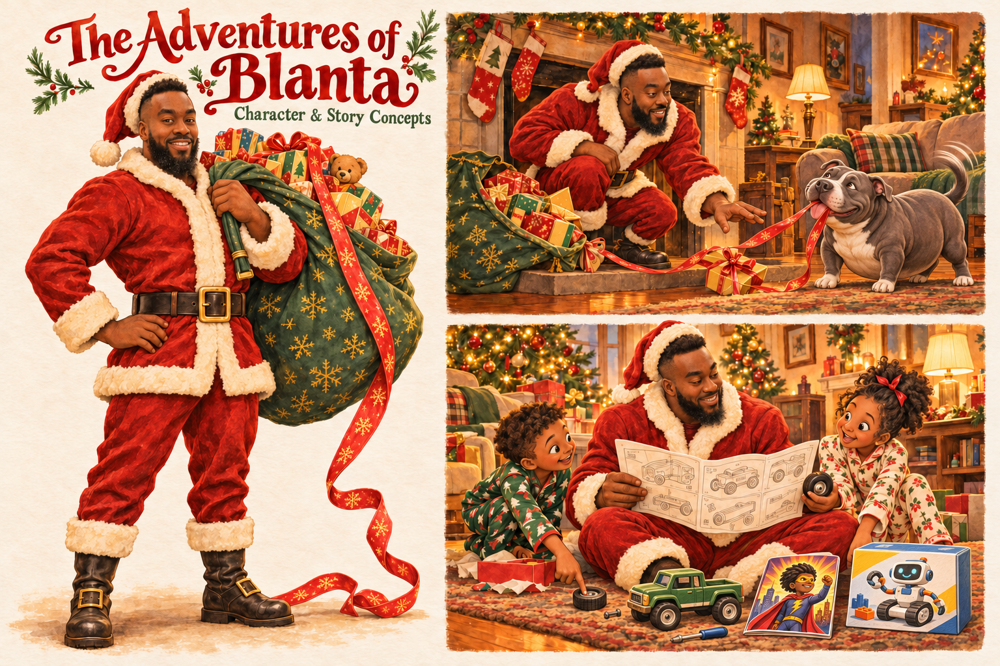

# The Adventures of Blanta

Character and story concept art for a short, funny Christmas book starring Blanta, aka Black Santa.

## Current concept

A fit Blanta with a dark beard, textured haircut, natural gaze, and a chubby pit bull in the holiday scene.

[View or download the full-size artwork](https://raw.githubusercontent.com/venticlaw/adventures-of-blanta/main/blanta-concept-art-v3.png)

## Blanta's three gifts

Every child always receives three gifts:

1. A toy.
2. A Black / urban item.
3. Something that will help their future.

This scene uses a toy truck, an original Black superhero comic, and a beginner robotics kit as an example trio.

[Character notes](CHARACTER-NOTES.md)

## Earlier concepts

- [Version 2](blanta-concept-art-v2.png)
- [Original concept](blanta-concept-art.png)

Early concept artwork created with AI image generation for visual review.
